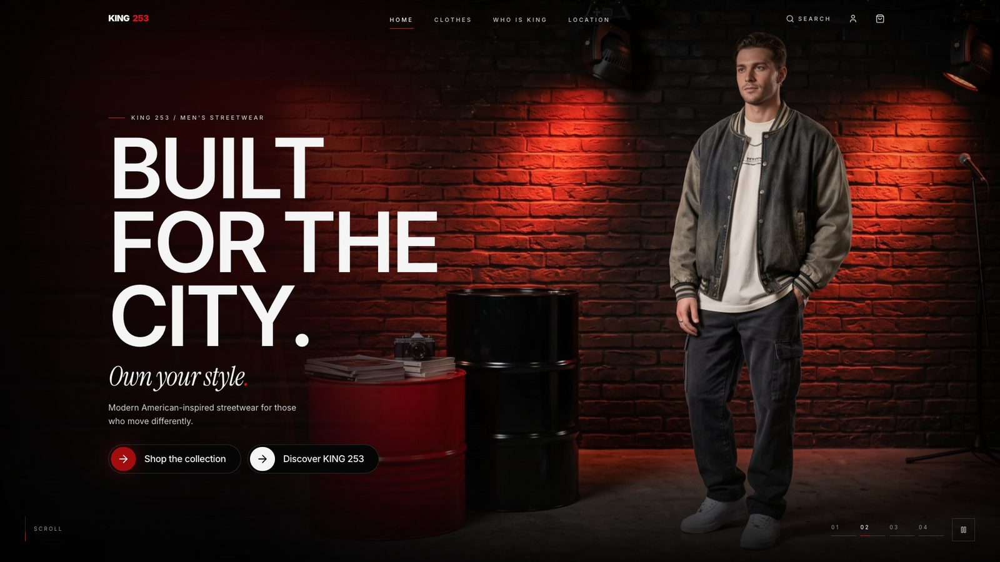
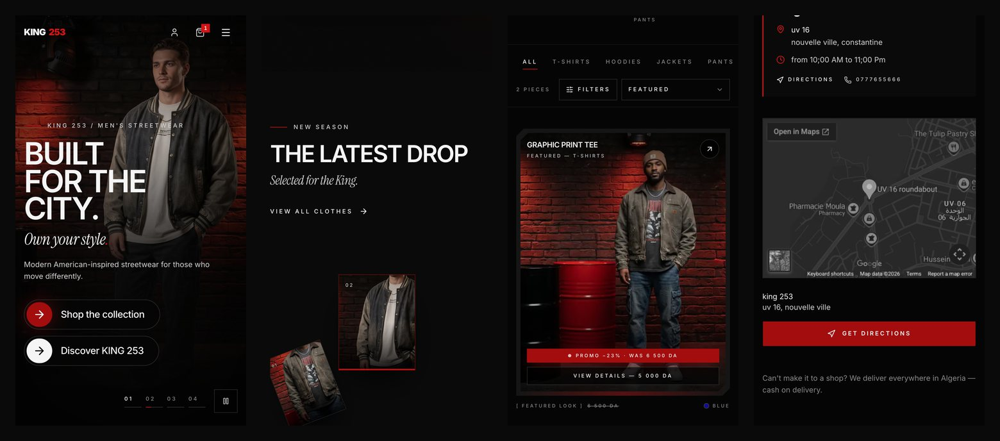
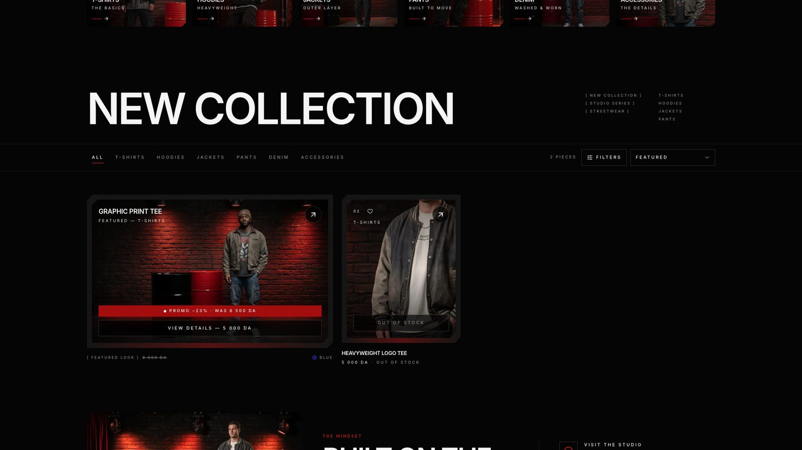
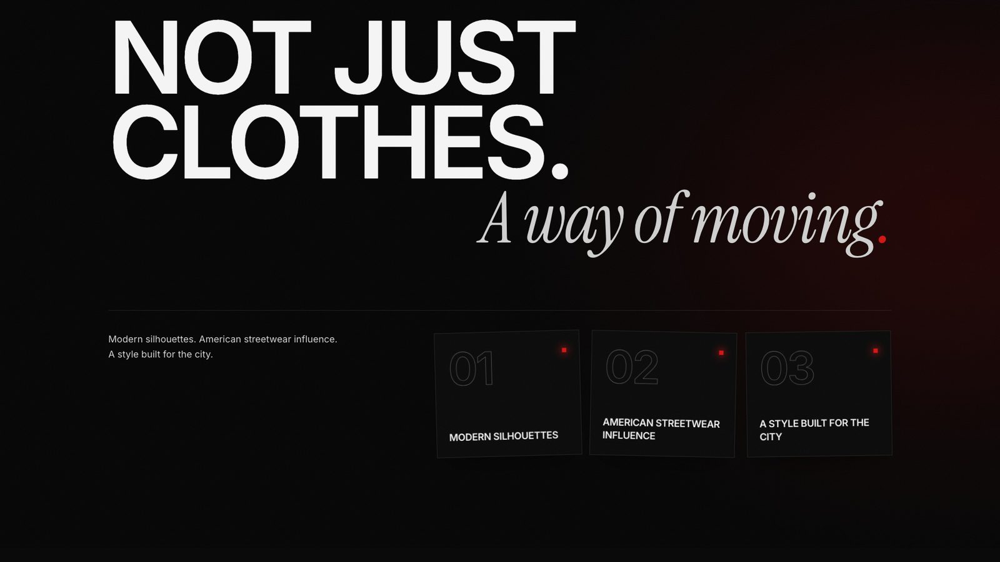

<div align="center">

# KING 253 — Streetwear E-commerce

**A complete online store for an Algerian men's streetwear brand.**
Storefront, cash-on-delivery checkout for all 69 wilayas, customer accounts, stock management and a full admin dashboard.




</div>

## Overview

KING 253 is a custom-built e-commerce platform (not a template) designed around the brand's identity:
a dark studio look with red light, brick textures and bold condensed typography. It is built
**mobile-first**, because most customers shop from their phone, and is tailored to the Algerian market:
prices in **DA**, **cash on delivery**, and delivery to **all 69 wilayas** with their communes.

The admin dashboard lets the shop owner run the whole business without a developer: orders, products,
colours and photos, stock, returns, customers, site content and settings.

<p align="center">
  
</p>

## Features

### Storefront
- Home, collection, product, "Who is King" and shop-location pages with scroll animations
- Catalogue with **categories and subcategories**, filters and sorting
- Product pages with **photos per colour**, sizes, hover zoom and full-screen viewer
- **Prices and promotions** per product and per colour, with promo badges on cards
- Wishlist, bag, quick "Buy now", recently viewed products
- "Find the closest shop" with an embedded map

### Checkout & delivery
- **Cash on delivery** — no online payment needed
- All **69 wilayas and their communes** in dropdowns
- Delivery fee, **free delivery** from a chosen amount, and **one shared delivery** when a customer orders again before the first parcel arrives
- Account required to order (the bag is kept while signing up)

### Customer accounts
- **My orders** with live progress, cancellation while the order is still pending
- Saved delivery details, password change, account deletion
- **Order tracking** by order number + phone, **returns and exchanges** requests
- "How did you find us?" question (TikTok, Instagram, Facebook…) for marketing stats

### Admin dashboard (iOS-style, works on phone)
- **Dashboard**: net revenue (sales − refunds − delivery paid), orders, average order value, conversion, units sold, daily performance line chart with comparison to the previous period
- **Orders**: status workflow, call / WhatsApp buttons, discounts, delivery edits, internal notes, timeline and audit log
- **Products**: colours, photos, sizes, SKUs, prices and promos, categories
- **Stock** with reservations: *physical − reserved = available*, full movement history, low-stock alerts, restock and stock-count tools
- **Returns & exchanges** (resellable items go back to stock, refunds are deducted from revenue)
- Customers, users and admins, reviews moderation, testimonials, abandoned carts, social-media sign-up stats
- **Content editor** for the texts and images of the main pages, shop locations, and settings
- **Vacation mode**: close the shop for chosen dates — visitors see a "We'll be back" page (orders are blocked, existing orders can still be tracked) and the shop **reopens automatically**
- **Email notifications** for new orders and order status changes (SMTP)

<table>
  <tr>
    <td></td>
    <td></td>
  </tr>
</table>

## Tech stack

| Area | Technology |
|---|---|
| Framework | Next.js 16 (App Router, Server Actions, Turbopack) · React 19 · TypeScript |
| Styling | Tailwind CSS 4 · Radix UI · Lucide icons |
| Motion | Framer Motion · GSAP ScrollTrigger · Lenis |
| Data | PostgreSQL · Drizzle ORM · Zod validation |
| Charts | Recharts |
| Email | Nodemailer (SMTP) |
| Tests | Vitest (integration tests against a real test database) |

## Getting started

### Requirements
- **Node.js 20+**
- **PostgreSQL** (two databases: one for the app, one for tests)

### 1. Install
```bash
git clone https://github.com/zack-zdj100k/king253-ecommerce.git
cd king253-ecommerce
npm install
```

### 2. Configure
Copy the example environment file and fill in your values:
```bash
cp .env.example .env.local
```

| Variable | Purpose |
|---|---|
| `DATABASE_URL` | PostgreSQL connection string (required) |
| `TEST_DATABASE_URL` | Separate database for `npm test` — wiped between runs |
| `NEXT_PUBLIC_SITE_URL` | Public URL of the site (canonical URLs, sitemap, emails) |
| `NEXT_SERVER_ACTIONS_ENCRYPTION_KEY` | Stable key when running several instances (`openssl rand -base64 32`) |
| `SMTP_HOST` `SMTP_PORT` `SMTP_USER` `SMTP_PASS` `SMTP_FROM` | Order emails. Leave `SMTP_HOST` empty to disable sending |
| `UPLOAD_DIR` | Where uploaded product images are stored (default `./storage/uploads`) |

### 3. Database
```bash
npm run db:migrate     # create the tables
npm run db:seed        # categories + campaign pieces as draft products
npm run admin:create -- you@example.com "Your Name"   # first admin account
```

### 4. Run
```bash
npm run dev
```
- Shop: http://localhost:3000
- Admin: http://localhost:3000/admin

## Scripts

| Command | What it does |
|---|---|
| `npm run dev` | Development server |
| `npm run build` / `npm start` | Production build / start |
| `npm test` | Run the test suite |
| `npm run lint` | ESLint |
| `npm run db:migrate` | Apply SQL migrations from `drizzle/` |
| `npm run db:generate` | Generate a migration from the schema |
| `npm run db:seed` | Seed categories and draft products (safe to re-run) |
| `npm run db:studio` | Browse the database with Drizzle Studio |
| `npm run admin:create` | Create or promote an admin account |
| `npm run db:demo` | **Local only** — fill the database with labelled demo data |
| `npm run db:reset` | **Local only** — wipe the database, re-migrate and re-seed |

## Project structure

```
src/
├── app/
│   ├── (site)/        storefront pages (home, clothes, product, checkout, account, track…)
│   ├── admin/         admin dashboard pages and server actions
│   ├── actions/       storefront server actions
│   └── api/, media/   API routes and uploaded media
├── components/        UI components (shop, product, admin, orders, layout, ui)
├── lib/               shared helpers (pricing rules, Algeria wilayas, phone, closure…)
└── server/            database schema, queries, orders, stock, emails, auth
drizzle/               SQL migrations
scripts/               database and admin scripts
tests/                 Vitest integration tests
docs/                  screenshots and client documents (quote, admin guide — FR / AR)
```

## Security notes
- Passwords are hashed with **scrypt**; sessions are server-side
- All admin actions require an admin session and are recorded in an **audit log**
- Rate limiting on sign-in, sign-up and checkout
- Prices, stock and totals are always recalculated on the server — never trusted from the browser
- Secrets live only in `.env.local`, which is never committed

## Author

Designed and developed by **Zack Saidani** for KING 253.

© 2026 KING 253. All rights reserved.
